# Class Registration System — Python (version 3)

A complete, working class-registration project in three parts, built entirely on the
Python standard library — **no pip installs required**.

| # | Item | File(s) | What it is |
|---|------|---------|------------|
| 1 | **Course Sheet** | `courses.csv` (+ Course Sheet tab in `server_gui.py`) | Every course session with its time, venue and candidate limit. 42 sections across 3 terms, including courses that appear several times (different sessions) and deliberate time overlaps. |
| 2 | **Client-side program** | `client_gui.py` | **Login window**, term selector, hash-table course search, registration form, drop-in weekly **timetable**, and an admin window for staff. |
| 3 | **Server-side program** | `server.py` (JSON API + SQLite + two dictionaries) and `server_gui.py` (desktop console) | Receives and stores registrations, keeps a students dictionary and a course-code dictionary, serves different courses per term, authenticates logins, and lets staff add accounts and switch a student's ability to register. |

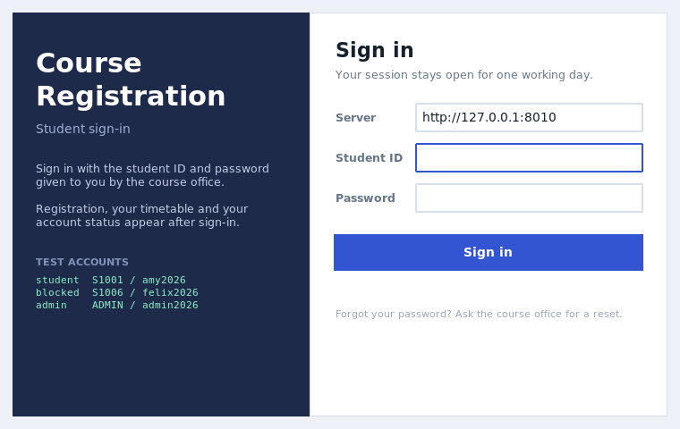

---

## 1. Quick start

Two terminals, in this folder.

```bash
# Terminal 1 - the server (creates data/registration.db on first run)
python3 server_gui.py --demo         # desktop console + API on http://0.0.0.0:8000
# or headless:
python3 server.py --demo

# Terminal 2 - the student client
python3 client_gui.py                                   # connects to 127.0.0.1:8000
python3 client_gui.py --server http://192.168.1.20:8000  # connect to another machine
```

Then sign in. The client will not open the registration screen until the server has
accepted a student id and password (requirement 5).

| Account | Password | What it demonstrates |
|---|---|---|
| `S1001` | `amy2026` | ordinary student — the full system |
| `S1006` | `felix2026` | a **blocked** student (`can_register = 0` in `students.csv`) |
| `ADMIN` | `admin2026` | the hard-coded **admin test account** (requirement 1) — extra "Manage accounts" button |

All sixteen `S1001`–`S1016` accounts are listed in `students.csv`; each password is the
first name in lower case followed by `2026` (`brian2026`, `chloe2026`, …).

Self-checks and the comment report:

```bash
python3 test_registration.py       # 75 tests: sheet, dictionaries, rules, accounts, HTTP, migration
python3 comment_ratio.py           # shows the comment ratio (requirement: >= 30%)
```

Requirements: **Python 3.10+ with Tkinter** (bundled with the python.org installers; on
Debian/Ubuntu `sudo apt install python3-tk`).

> Upgrading from version 1 or 2? An old `data/registration.db` is detected by its schema
> version, backed up and upgraded in place — existing registrations are kept, and every
> pre-existing student gets `can_register = 1`, the role `student` and an empty password
> that a staff member can set from either console.

---

## 2. What version 3 adds

| Requirement | Where it lives | How it works |
|---|---|---|
| **1. A hard-coded admin-only test account (server side)** | `server.py` → `ADMIN_ACCOUNT` / `authenticate()` | `ADMIN` / `admin2026` is inserted at start-up with `role = "admin"` and `builtin = True`. It is checked *before* the database, so it works even on an empty install, and it is never written to `students.csv`. `create_server(..., admin_account=None)` removes it entirely (a test covers that). The server prints a dev-only warning on start-up because a fixed password in source code is a demonstration feature, not a production one. |
| **2. Adding more students to the dictionary (server side)** | `server.py` → `CourseDB.add_student()` + `POST /api/admin/students`; console: **New student …** | One function, three callers (API, console, tests). It validates the id (`^[A-Za-z0-9_-]{3,20}$`), a name of at least two characters, an e-mail address and a password of at least six characters, hashes the password, and refuses a duplicate id with `409 STUDENT_EXISTS`. The new account can log in immediately. |
| **3. Switching a student's ability to register (server side)** | `server.py` → `CourseDB.set_registration_access()` + `POST /api/admin/students/<id>/access`; console: **Allow / Block registration** | Sets `can_register`. Registering then fails with `403 REGISTRATION_BLOCKED` while the account keeps working: it can sign in, browse the sheet and see its own timetable. Blocking never deletes existing registrations — a blocked student may still drop a class. |
| **4. Passwords in the student CSV (server side)** | `students.csv` → the `password` column; `server.py` → `hash_password()` | The CSV holds the **readable** password for staff, but the server hashes it with PBKDF2-HMAC-SHA256 (120 000 iterations, per-account random salt) before storing it in the separate `student_secrets` table. The hash travels nowhere: no endpoint returns it, and `hmac.compare_digest` is used for the comparison so a wrong password cannot be found by timing. |
| **5. Login system on the client (client side)** | `client_gui.py` → `class LoginWindow`, `ApiClient(token)` | A separate `Tk` root that must succeed before the main window is even constructed. On success the server returns a session token (8 hours); every later request carries it in an `X-Auth-Token` header, and the client never sends a student id with a registration — the server takes the identity from the session, so it cannot be faked. `Sign out` destroys the token on both sides. |

---

## 3. What version 2 added (still in place)

| Feature | Where it lives | How it works |
|---|---|---|
| **Timetable replacing the registrations list** | `client_gui.py` → `class Timetable` | A `Canvas` grid: days across, 30-minute rows down. Every registration is a coloured block positioned from its real start/end. Click a block to select it, then **Drop selected**. |
| **More courses, some overlapping in time** | `courses.csv` | 42 sections; 7 deliberately overlapping section pairs in 2026 Term 1 (e.g. `CS101-C` and `MA110-A` are both Mon 11:00–12:30). |
| **Same course may reappear, but only one session may be picked** | `courses.csv` + `server.py` rule | A section id is `year-Tterm-CODE-SECTION` (e.g. `2026-T1-CS101-B`). The server refuses a second session of the same code in the same term with `ONE_SESSION`. |
| **Dictionary of student info** | `server.py` → `CourseDB.students` | `{student_id: {name, email, role, can_register, created_at}}`, mirrored in the `students` table. |
| **Dictionary of course codes** | `server.py` → `CourseDB.course_index` | `{(year, term): {code: [section ids]}}`, built while loading; answers "which sessions does CS101 have?" in O(1). |
| **Term / year selection** | header of both GUIs | Filled from `GET /api/terms`; every request then carries `?year=&term=`. |
| **Search using a hash table** | `client_gui.py` → `class SearchIndex` | Inverted index `{word: {section ids}}`; a query is a few dictionary lookups plus a set intersection, timed on screen (typically 0.01–0.03 ms). |
| **Different courses per term** | `server.py` | `GET /api/courses?year=2026&term=2` filters in SQL. The three terms genuinely differ (19 / 13 / 10 sections). |

---

## 4. Item 1 — the Course Sheet

`courses.csv` is the single source of truth for courses. One row = one **section**:

| column | meaning |
|--------|---------|
| `year`, `term` | which term the section belongs to (`2026`, `1`) |
| `code` | course code, e.g. `CS101` — **may repeat** across sessions |
| `section` | session letter within the term, `A`, `B`, `C`… |
| `title`, `instructor`, `department`, `credits`, `description` | course details |
| `day`, `start`, `end` | timetable slot |
| `venue` | where the class meets |
| `capacity` | **candidate limit** |

```csv
year,term,code,section,title,instructor,department,day,start,end,venue,capacity,credits,description
2026,1,CS101,A,Introduction to Programming,Dr. Alice Chan,Computer Science,Mon,09:00,10:30,Science Hall R101,40,3,...
2026,1,CS101,B,Introduction to Programming,Dr. Alice Chan,Computer Science,Wed,09:00,10:30,Science Hall R101,40,3,...
2026,1,CS101,C,Introduction to Programming,Mr. Roy Tang,Computer Science,Mon,11:00,12:30,Science Hall R105,35,3,...
```

| Term | Sections | Courses | Notes |
|---|---|---|---|
| 2026 · Term 1 | 19 | 12 | 6 codes with 2–3 sessions, 7 overlapping pairs |
| 2026 · Term 2 | 13 | 11 | different catalogue, `CS205` returns |
| 2027 · Term 1 | 10 | 9 | new academic year, `CS101` and `MA110` return |

Editing it: change the CSV, then press **Reload from CSV** in the console (or restart).
Rows are upserted, vanished rows are removed, registrations are kept.

---

## 5. Item 2 — the client program

**Sign in (requirement 5).** The window on the first page asks for the server address,
the student id and the password. The field is masked, a wrong pair produces
"Wrong student ID or password." in red (the server does not say which half was wrong),
and the main window is not created until the server answers with a token.

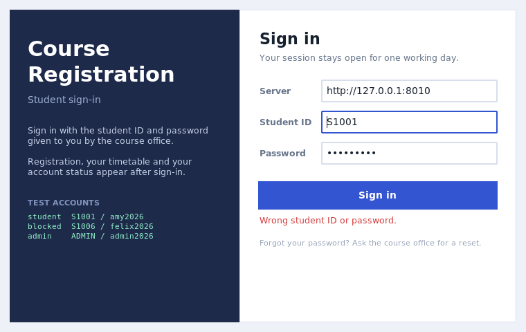

**Main window after signing in.** The header shows who you are, your role badge and a
`Sign out` button; the left panel is the term's course sheet, the right panel is the
registration form and the timetable.

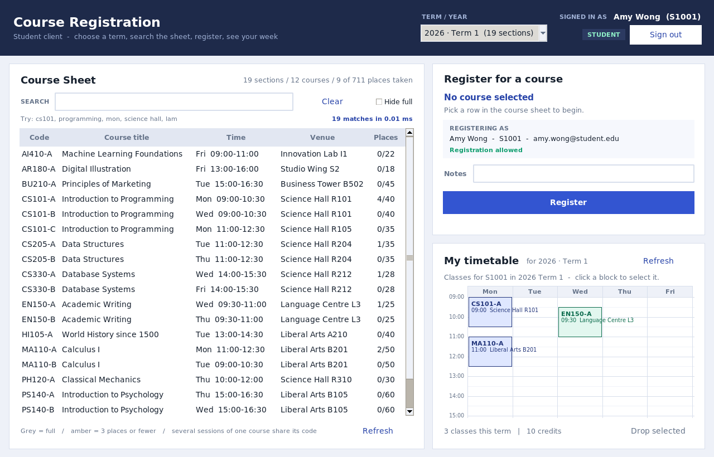

**Blocked account.** `S1006` can sign in and browse, but the **Register** button is
disabled and the reason is spelled out rather than the click being silently ignored:

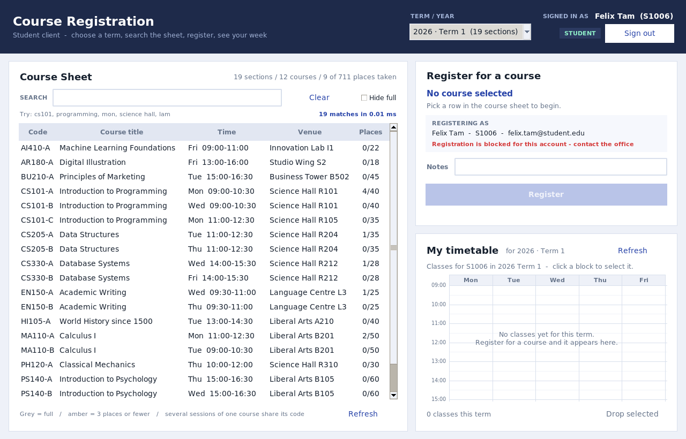

**Hash search.** Typing filters instantly: `cs101` finds all three sessions, `mon` finds
everything on Monday, `science hall` finds by venue, `lam` finds by instructor. The
status line reports the match count and the milliseconds spent.

**Registration form.** Pick a section row; the panel shows which session it is
("session B of 2"), places left, instructor and credits, plus the account the
registration will be filed under. Refusals appear in the same place, with the server's
own explanation:

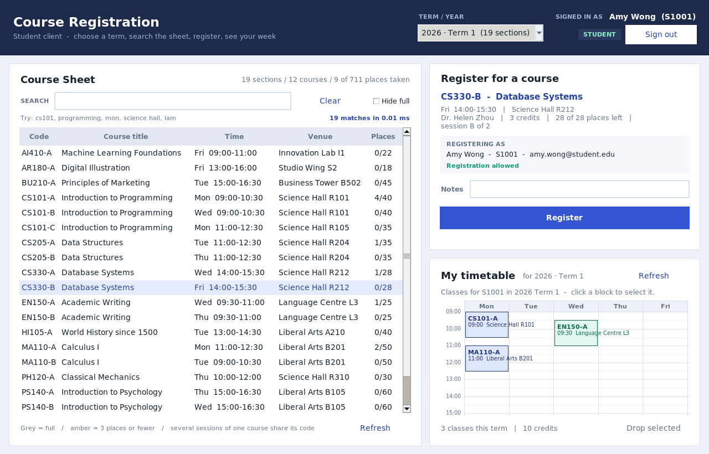

**Timetable.** Weekly grid, coloured per course, positioned from the real times, spanning
only the hours actually used. Click a block → **Drop selected** removes it (after a
confirmation) and the seat is freed immediately.

**Admin window (only for `role == "admin"`).** `Manage accounts` opens a list of every
account with its role, registration state and number of classes. Two jobs, exactly the
two admin endpoints: **Allow / Block registration** for the selected row, and an inline
form that adds a new student.

The admin account has no timetable of its own (`Sign in as ADMIN` → empty week), which
is the point: an admin is staff, not a student.

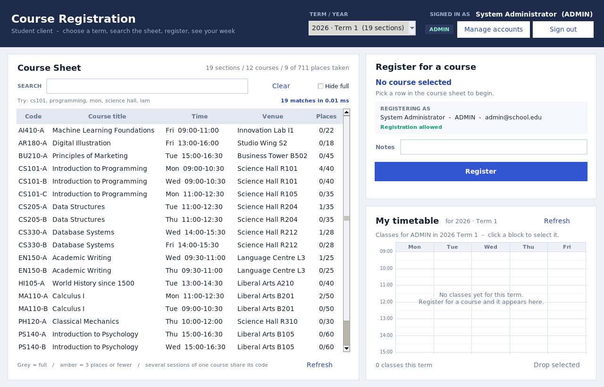

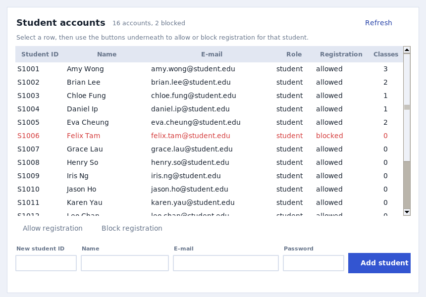

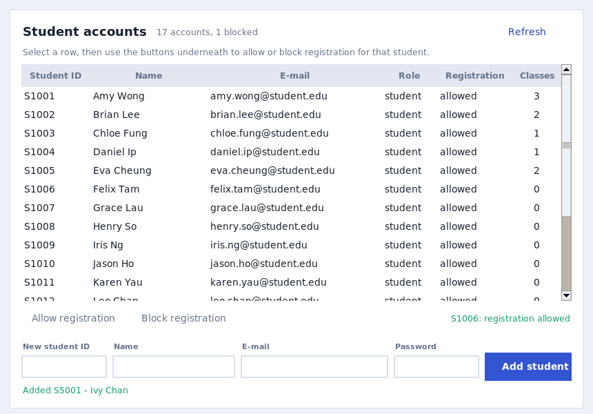

Hiding this button from students is a convenience, not the protection: every request it
makes goes to `/api/admin/…`, which the server answers `403 FORBIDDEN` for a non-admin
session (there is a test for that). Every network call runs in a worker thread, so no
window ever freezes.

---

## 6. Item 3 — the server program

### 6a. `server.py` — API, storage, accounts and rules

* `http.server.ThreadingHTTPServer` + `sqlite3`, **schema version 3**.
* Tables: `courses` (sections), `students` (the dictionary + `can_register` + `role`),
  `student_secrets` (salt and hash only), `registrations`, `sessions`, `activity_log`.
* The registration rules are enforced **inside one locked transaction**, so parallel
  clients cannot oversell a seat, double-book a student, or take two sessions of one
  course.

| Rule | Error code | HTTP |
|------|-----------|------|
| no `X-Auth-Token`, expired token or bad credentials | `AUTH_REQUIRED` / `BAD_LOGIN` | 401 |
| signing in while the account is blocked | *(allowed — reading is fine)* | 200 |
| **registering while `can_register = 0`** | `REGISTRATION_BLOCKED` | 403 |
| **a student calling an admin endpoint** | `FORBIDDEN` | 403 |
| **adding a student id that already exists** | `STUDENT_EXISTS` | 409 |
| bad section id, section full, duplicate, second session, time clash | `NO_SUCH_COURSE` / `FULL` / `DUPLICATE` / `ONE_SESSION` / `TIME_CONFLICT` | 404 / 409 |
| incomplete or invalid new-account details | `VALIDATION` | 400 |
| unknown student id in an admin call | `NO_SUCH_STUDENT` | 404 |

**Endpoints** (🔒 = needs `X-Auth-Token`, 👑 = admin role only)

| Method | Path | Purpose |
|--------|------|---------|
| `GET` | `/api/health` | is the server up? (also reports student count and whether the dev admin is on) |
| `POST` | `/api/login` | `{student_id, password}` → `{token, expires_in, role, student}` |
| `POST` | `/api/logout` 🔒 | end the session |
| `GET` | `/api/me` 🔒 | who am I, and may I still register? |
| `GET` | `/api/terms` 🔒 | every (year, term) with section counts |
| `GET` | `/api/courses?year=&term=` 🔒 | **the course sheet for one term** |
| `GET` | `/api/courses/search?year=&term=&q=` 🔒 | server-side search |
| `GET` | `/api/students` 🔒 | the student dictionary |
| `GET` | `/api/students/<id>` 🔒 | one student + their registrations |
| `GET` | `/api/registrations?year=&term=` 🔒 | **retrieve** the caller's registrations (an admin may pass `?student_id=`) |
| `POST` | `/api/registrations` 🔒 | register `{section_id, notes}` — identity from the token |
| `DELETE` | `/api/registrations/<id>` 🔒 | cancel (only your own, unless admin) |
| `GET` | `/api/admin/students` 👑 | every account with role, access and class count |
| `POST` | `/api/admin/students` 👑 | add `{student_id, name, email, password, can_register}` |
| `POST` | `/api/admin/students/<id>/access` 👑 | `{can_register: true/false}` |
| `POST` | `/api/admin/students/<id>/password` 👑 | `{password}` — reset |
| `GET` | `/api/stats?year=&term=` 🔒 | counters |
| `GET` | `/` | HTML view of the sheet (term links, no JavaScript) |

```bash
TOKEN=$(curl -s -X POST http://127.0.0.1:8000/api/login -H 'Content-Type: application/json' \
        -d '{"student_id":"S1001","password":"amy2026"}' | python3 -c 'import json,sys;print(json.load(sys.stdin)["token"])')
curl -H "X-Auth-Token: $TOKEN" "http://127.0.0.1:8000/api/courses?year=2026&term=1"
curl -X POST http://127.0.0.1:8000/api/registrations -H "X-Auth-Token: $TOKEN" \
     -H 'Content-Type: application/json' -d '{"section_id":"2026-T1-CS101-B"}'
```

```bash
# staff side: block a student, then add a new account
ADMIN=$(curl -s -X POST http://127.0.0.1:8000/api/login -H 'Content-Type: application/json' \
        -d '{"student_id":"ADMIN","password":"admin2026"}' | python3 -c 'import json,sys;print(json.load(sys.stdin)["token"])')
curl -X POST http://127.0.0.1:8000/api/admin/students/S1014/access \
     -H "X-Auth-Token: $ADMIN" -H 'Content-Type: application/json' -d '{"can_register":false}'
curl -X POST http://127.0.0.1:8000/api/admin/students \
     -H "X-Auth-Token: $ADMIN" -H 'Content-Type: application/json' \
     -d '{"student_id":"S5001","name":"Ivy Chan","email":"ivy.chan@student.edu","password":"ivy2026"}'
```

### 6b. `students.csv` — the account list

```csv
student_id,name,email,password,can_register,role
S1001,Amy Wong,amy.wong@student.edu,amy2026,1,student
S1006,Felix Tam,felix.tam@student.edu,felix2026,0,student
```

| column | meaning |
|---|---|
| `student_id` | the id students type at the login window (also the dictionary key) |
| `name`, `email` | shown in both GUIs and stored once per student |
| `password` | the readable password for staff; hashed by the server before storage |
| `can_register` | `1` allowed, `0` blocked from now on (requirement 3 in file form) |
| `role` | `student` or `admin` |

The file is read with `--students students.csv` (default: next to `server.py`) and can be
left out entirely — the server then starts with the built-in admin account only. New
accounts added through the API or either console go into the database; press
**Reload from CSV** to re-read the file, which updates matching ids and never deletes an
account that is no longer listed.

### 6c. The two dictionaries

```python
# course_index: built from courses.csv while loading; refuses repeated section ids
{(2026, 1): {"CS101": ["2026-T1-CS101-A", "2026-T1-CS101-B", "2026-T1-CS101-C"],
             "MA110": ["2026-T1-MA110-A", "2026-T1-MA110-B"], ...}}

# students: one record per person, so details are never stored twice
{"S1001": {"student_id": "S1001", "name": "Amy Wong", "email": "amy.wong@student.edu",
           "role": "student", "can_register": True, "created_at": "2026-11-07 09:12:44"}}
```

`course_index` makes the "one session per course" rule cheap: the server looks up the
siblings of `CS101-B` instead of scanning the registration table. `students` makes a
returning student a single id, and is also what the admin features write to — there is
exactly one place where an account exists.

### 6d. `server_gui.py` — the staff console

| Tab | Contents |
|-----|----------|
| **Overview** | counters (registrations, unique students, seats filled, full sections) + a fill bar per section; the account counts live on the Students tab |
| **Course Sheet** | section id, code, session, instructor, time, venue, limit and enrolled; repeated codes share a shaded block |
| **Registrations** | every registration for the selected term — search, **Export CSV**, **Cancel selected** |
| **Students** | the account table: id, name, e-mail, role, registration state, first seen, class count. **Blocked rows are shown in red.** Toolbar: **New student …**, **Allow registration**, **Block registration** (requirements 2 and 3) |
| **Activity Log** | the API request log |

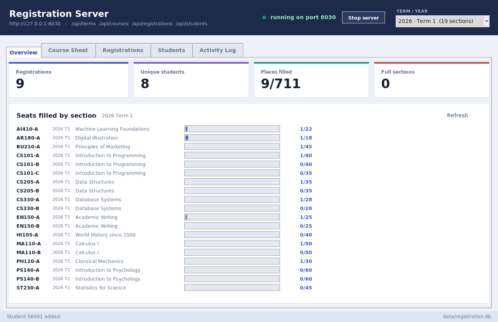

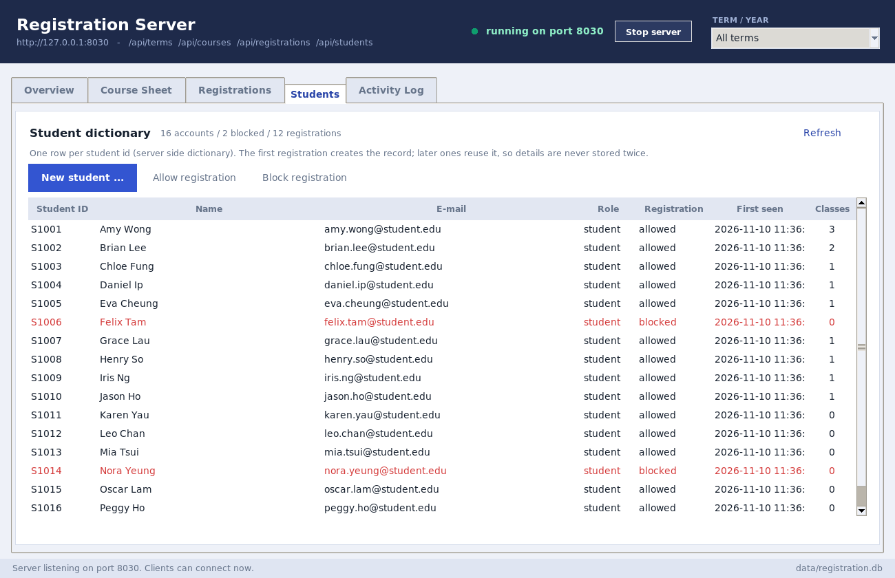

**Adding an account** opens a modal form. Validation is reported inside the dialog rather
than in a pop-up over it, so a mistyped field can be corrected without retyping the rest:

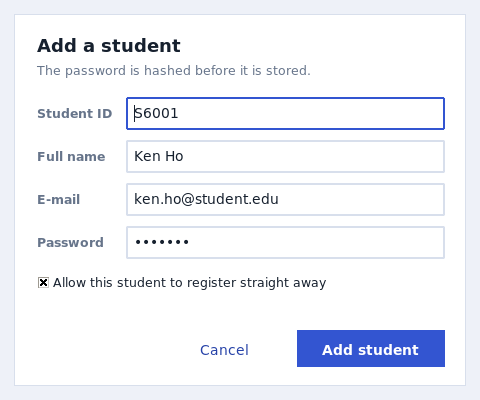

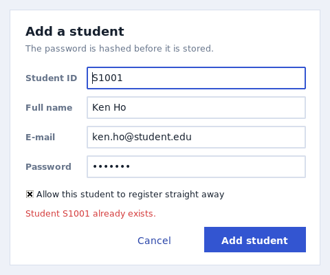

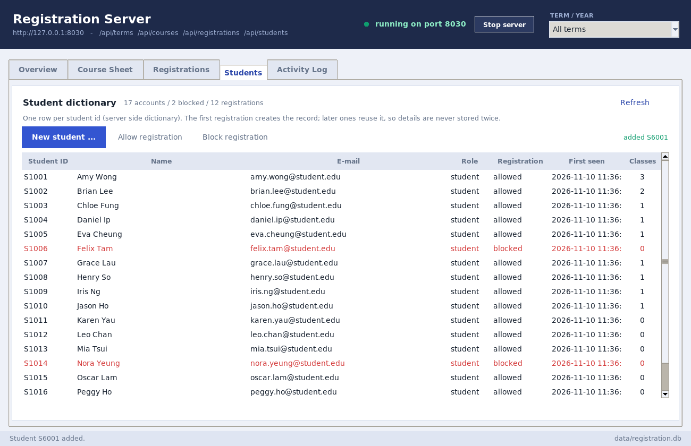

The console calls the same `CourseDB` methods as the HTTP API, so a rule can never be
enforced differently in the two places. The start-up log reports how many accounts were
loaded and warns loudly when the built-in development admin account is enabled.

---

## 7. Files

```
class_registration/
├── courses.csv              # ITEM 1 - the course sheet (42 sections, 3 terms)
├── students.csv             # the account list: ids, passwords, access, role
├── client_gui.py            # ITEM 2 - login window + student client
├── server.py                # ITEM 3 - API, SQLite, accounts, course_index + students
├── server_gui.py            # ITEM 3 - staff console
├── theme.py                 # shared colours / widget styles for both GUIs
├── test_registration.py     # 75 self-checks
├── comment_ratio.py         # measures the >= 30% comment requirement
├── README.md
├── data/                    # created at run time: registration.db, client_settings.json
└── screenshots/
```

**Comment coverage** (measured with `python3 comment_ratio.py`):

| file | lines | comment / docstring lines | ratio |
|---|---|---|---|
| server.py | 1601 | 540 | 33.7% |
| client_gui.py | 1522 | 460 | 30.2% |
| server_gui.py | 1004 | 303 | 30.2% |
| theme.py | 171 | 66 | 38.6% |
| test_registration.py | 813 | 245 | 30.1% |
| **total** | **5111** | **1614** | **31.6%** |

Every file clears 30% on its own, not just the project total.

---

## 8. How a registration flows now

```
client_gui.py                        server.py                     data/registration.db
  │  POST /api/login {student_id, password}
  ├───────────────────────────────────►│  admin table?  → accept
  │                                    │  students     → verify PBKDF2 hash
  │  200 {token, role, student}        │  sessions     → INSERT token
  │◄───────────────────────────────────┤
  │  every later call carries X-Auth-Token
  │  GET /api/courses?year=&term=      │
  ├───────────────────────────────────►│  token → student → courses of that term
  │  hash index rebuilt for that term  │
  │                                    │
  │  POST /api/registrations {section_id}
  ├───────────────────────────────────►│  lock → identity from session
  │                                    │  can_register?  REGISTRATION_BLOCKED
  │                                    │  capacity?      FULL
  │                                    │  duplicates?    DUPLICATE / ONE_SESSION
  │                                    │  clash?         TIME_CONFLICT
  │  201 {"registration": {...}}       ├──────────────────────────► INSERT
  │◄───────────────────────────────────┤
  │  refresh sheet + redraw timetable  │
```

---

## 9. Tests

```bash
python3 test_registration.py     # or: python3 -m unittest test_registration
```

| group | covers |
|---|---|
| `TestSheetLoading` | the CSV loads, its columns and terms |
| `TestDictionaries` | students and course-code dictionaries, no repetition |
| `TestRules` | capacity, duplicates, one-session-per-code, time clashes |
| `TestAccounts` | passwords hashed, admin account on/off, adding students, blocking, password reset, sessions |
| `TestHttpApi` | the real socket: tokens, 401/403, identity from the session, admin endpoints |
| `TestRealSheet` | the shipped `courses.csv` and `students.csv` themselves |
| `TestMigration` | a version 2 database upgraded in place to version 3 |

---

## 10. Notes on the demo accounts

* The `ADMIN` password is written into `server.py` because requirement 1 asks for a
  hard-coded test account. `python3 server.py --demo` is meant for a lab, not the
  internet: `create_server(..., admin_account=None)` turns it off, and a real deployment
  would create admin accounts through `students.csv` instead.
* The passwords in `students.csv` are readable on purpose — that is what requirement 4
  asks for. Only the **hash** is stored in the database, so a copy of
  `registration.db` does not reveal them.
* Sessions expire after 8 hours (`expires_in`), and `Sign out` revokes the token on the
  server rather than only forgetting it locally.

---

## 11. Ideas to extend it

* Waitlists: when `capacity` is reached, store the request with status `waitlisted`.
* Prerequisites per course (the description field already mentions one for `AI410`).
* A "must change password" flag set by the admin reset endpoint.
* Lock a student after N failed logins, using the `activity_log` table that is already
  recording every request.
* Room capacity check: warn when a section's `capacity` exceeds the room's seats.
* A printable timetable export (PDF) from the client's canvas.

_Tested with Python 3.13 on Linux; the Tkinter GUIs run unchanged on Windows and macOS._
