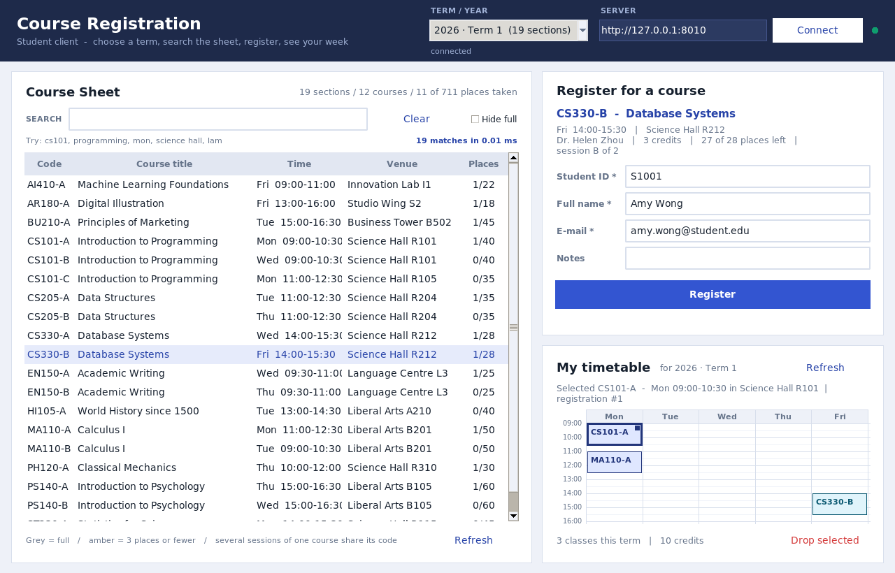
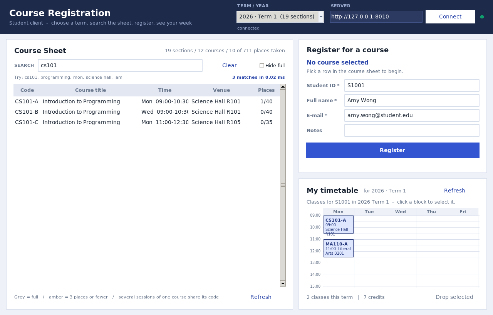
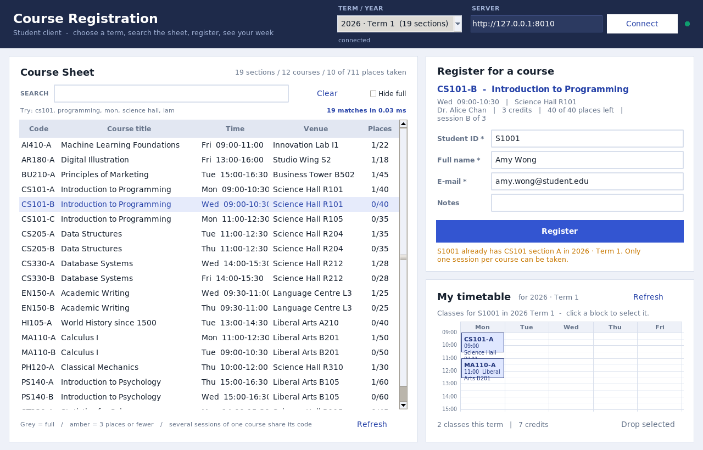
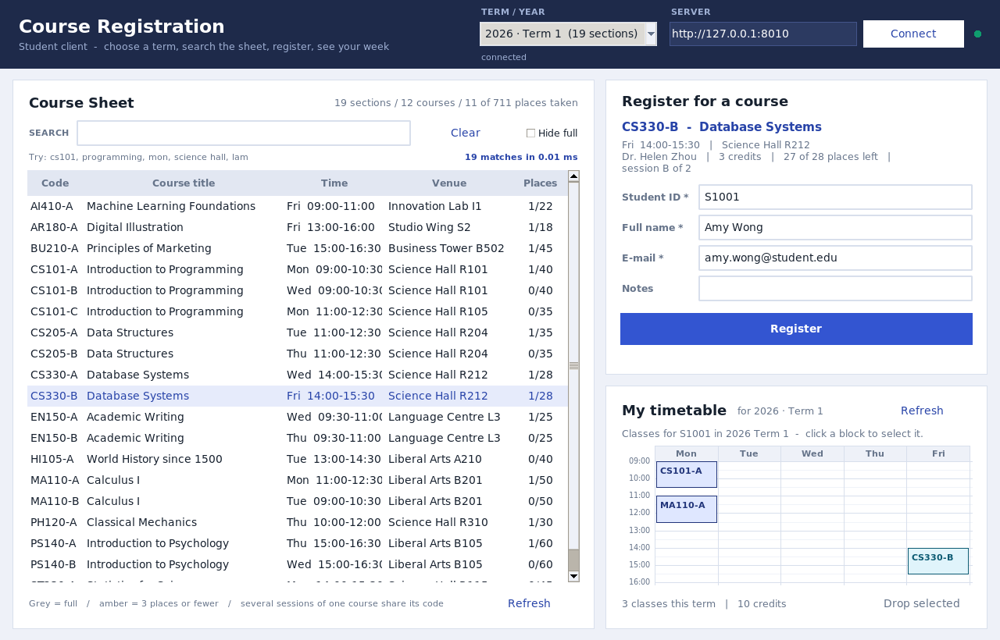
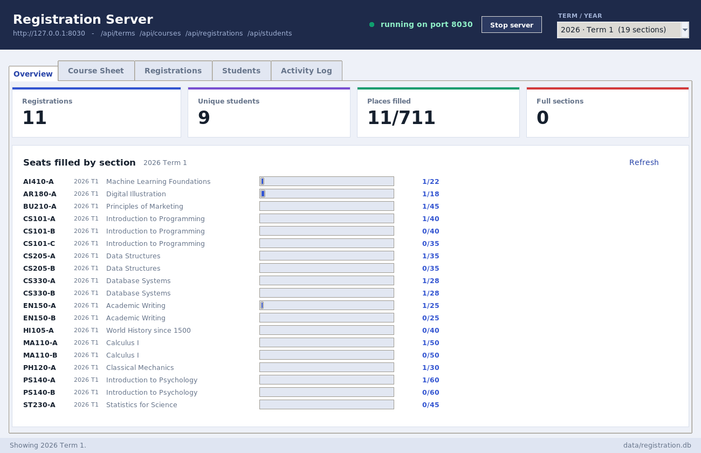
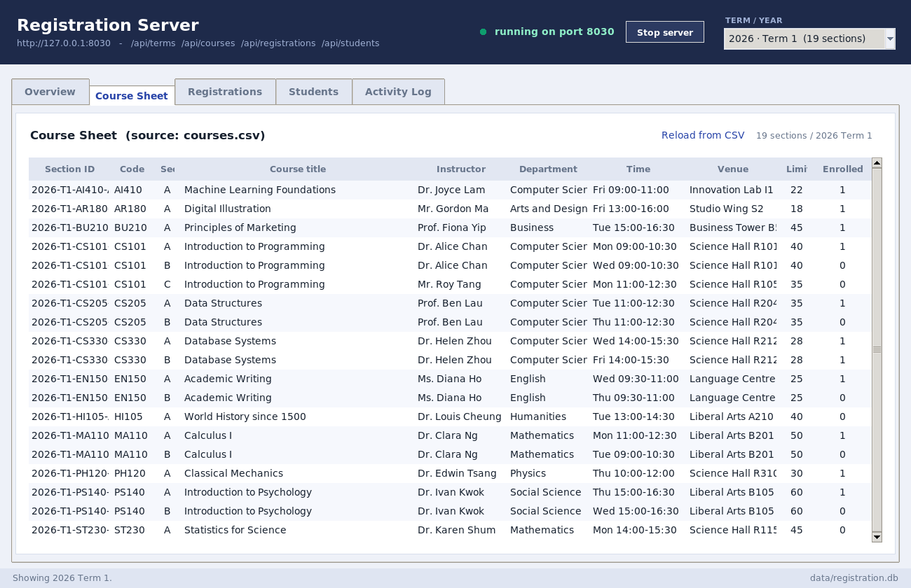
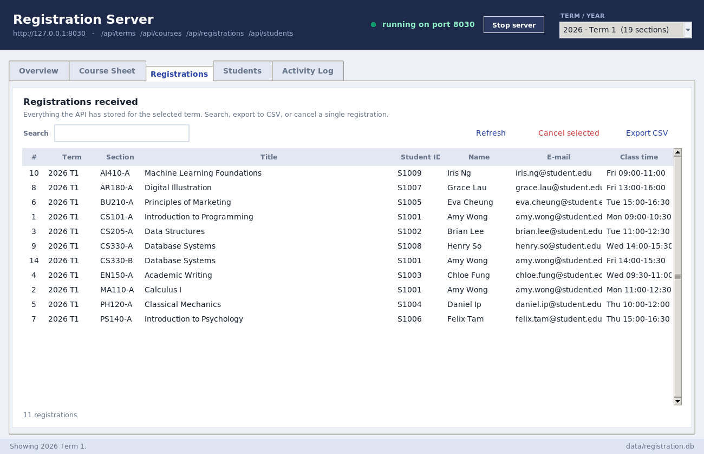
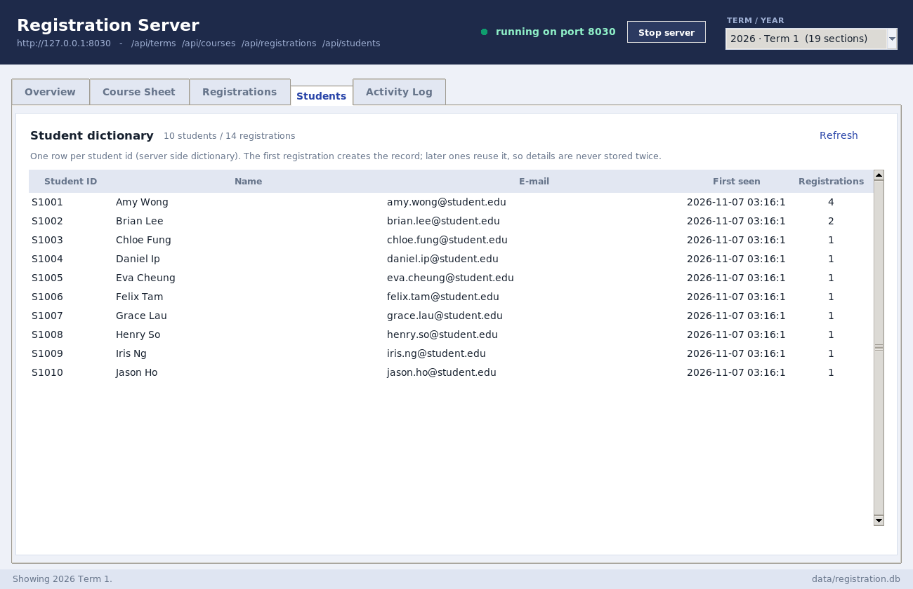

# Class Registration System — Python (version 2)

A complete, working class-registration project in three parts, built entirely on the
Python standard library — **no pip installs required**.

| # | Item | File(s) | What it is |
|---|------|---------|------------|
| 1 | **Course Sheet** | `courses.csv` (+ Course Sheet tab in `server_gui.py`) | Every course session with its time, venue and candidate limit. 42 sections across 3 terms, including courses that appear several times (different sessions) and deliberate time overlaps. |
| 2 | **Client-side program** | `client_gui.py` | Term selector, hash-table course search, registration form, drop-in weekly **timetable**. |
| 3 | **Server-side program** | `server.py` (JSON API + SQLite + two dictionaries) and `server_gui.py` (desktop console) | Receives and stores registrations, keeps a students dictionary and a course-code dictionary, serves different courses per term, and lets staff retrieve, search, export and cancel. |



---

## 1. Quick start

Two terminals, in this folder.

```bash
# Terminal 1 - the server (creates data/registration.db on first run)
python3 server_gui.py --demo         # desktop console + API on http://0.0.0.0:8000
# or headless:
python3 server.py --demo

# Terminal 2 - the student client
python3 client_gui.py                                   # connects to 127.0.0.1:8000
python3 client_gui.py --server http://192.168.1.20:8000  # connect to another machine
```

Self-checks and the comment report:

```bash
python3 test_registration.py       # 33 tests: sheet, dictionaries, rules, HTTP
python3 comment_ratio.py           # shows the comment ratio (requirement: >= 30%)
```

Requirements: **Python 3.10+ with Tkinter** (bundled with the python.org installers; on
Debian/Ubuntu `sudo apt install python3-tk`).

> Upgrading from version 1? An old `data/registration.db` is detected by its schema
> version, moved to `registration.v1-backup.db` and replaced — nothing is deleted.

---

## 2. What version 2 adds

| Requirement | Where it lives | How it works |
|---|---|---|
| **Timetable on the client, replacing the registrations list** | `client_gui.py` → `class Timetable` | A `Canvas` grid: days across, 30-minute rows down. Every registration is a coloured block positioned from its real start/end. Click a block to select it, then **Drop selected**. |
| **More courses, some overlapping in time** | `courses.csv` | 42 sections; 7 deliberately overlapping section pairs in 2026 Term 1 (e.g. `CS101-C` and `MA110-A` are both Mon 11:00–12:30). |
| **Same course may reappear (different sessions), but only one may be picked** | `courses.csv` + `server.py` rule | A section id is `year-Tterm-CODE-SECTION` (e.g. `2026-T1-CS101-B`). The server refuses a second session of the same code in the same term with `ONE_SESSION`. |
| **Dictionary of student info (no repetition)** | `server.py` → `CourseDB.students` | `{student_id: {name, email, created_at}}`, mirrored in the `students` table. First registration creates the record; later ones reuse it (a returning student only types their id). |
| **Dictionary of course codes (no repetition)** | `server.py` → `CourseDB.course_index` | `{(year, term): {code: [section ids]}}`. Built while loading; refuses a repeated section id and answers "which sessions does CS101 have?" in O(1). |
| **Term / year selection** | `client_gui.py` header | Dropdown filled from `GET /api/terms`; every request then carries `?year=&term=`, so both the sheet and the timetable follow the choice. |
| **Search system using a dictionary / hash table** | `client_gui.py` → `class SearchIndex` | Inverted index `{word: {section ids}}` built once per term; a query is a few dictionary lookups plus a set intersection. Live as you type — the status line shows the time taken (typically 0.01–0.03 ms). |
| **Server serves different courses per term** | `server.py` | `GET /api/courses?year=2026&term=2` filters in SQL; term 2 has 13 sections and 2027 Term 1 has 10, so the three terms genuinely differ. |

---

## 3. Item 1 — the Course Sheet

`courses.csv` is the single source of truth. One row = one **section**:

| column | meaning |
|--------|---------|
| `year`, `term` | which term the section belongs to (`2026`, `1`) |
| `code` | course code, e.g. `CS101` — **may repeat** across sessions |
| `section` | session letter within the term, `A`, `B`, `C`… |
| `title`, `instructor`, `department`, `credits`, `description` | course details |
| `day`, `start`, `end` | timetable slot |
| `venue` | where the class meets |
| `capacity` | **candidate limit** |

```csv
year,term,code,section,title,instructor,department,day,start,end,venue,capacity,credits,description
2026,1,CS101,A,Introduction to Programming,Dr. Alice Chan,Computer Science,Mon,09:00,10:30,Science Hall R101,40,3,...
2026,1,CS101,B,Introduction to Programming,Dr. Alice Chan,Computer Science,Wed,09:00,10:30,Science Hall R101,40,3,...
2026,1,CS101,C,Introduction to Programming,Mr. Roy Tang,Computer Science,Mon,11:00,12:30,Science Hall R105,35,3,...
```

Contents of the shipped sheet:

| Term | Sections | Courses | Notes |
|---|---|---|---|
| 2026 · Term 1 | 19 | 12 | 6 codes with 2–3 sessions, 7 overlapping pairs |
| 2026 · Term 2 | 13 | 11 | different catalogue, `CS205` returns |
| 2027 · Term 1 | 10 | 9 | new academic year, `CS101` and `MA110` return |

Editing it: change the CSV, then press **Reload from CSV** in the console (or restart).
Rows are upserted, vanished rows are removed, registrations are kept.
View it three ways: the console's **Course Sheet** tab, the browser page at
`http://<server>:8000/`, and `GET /api/courses?year=&term=`.

---

## 4. Item 2 — the client program

**Term selector (header).** Choosing a term reloads the sheet *and* the timetable. The
choice is remembered in `data/client_settings.json`.

**Hash search.** Typing in the search box filters instantly. The index maps words to
section ids, so `cs101` finds all three sessions, `mon` finds everything on Monday,
`science hall` finds by venue, and `lam` finds by instructor. The status line reports
both the match count and the milliseconds spent.



**Registration form.** Pick a section row; the panel shows which session it is
("session B of 2"), places left, instructor and credits. Register, and a green line
confirms with a reference number. Refusals appear in the same place with the server's
own explanation:



**Timetable.** The old registrations list is replaced by a weekly grid. Blocks are
coloured per course, positioned from the real times, and only span the hours that are
actually used. Click a block → it thickens and gets a marker → **Drop selected** removes
it (after a confirmation) and the seat frees up immediately.



**Returning students.** Leaving the student-id field triggers a dictionary lookup. A
known id fills in the name and e-mail and loads that student's timetable; an unknown id
is simply treated as a new student who must give their details.

Every network call runs in a worker thread, so the window never freezes.

---

## 5. Item 3 — the server program

### 5a. `server.py` — API, storage and rules

* `http.server.ThreadingHTTPServer` + `sqlite3`, schema version 2.
* Tables: `courses` (sections), `students` (the dictionary, one row per student),
  `registrations` (links a student to a section, unique per pair).
* The rules are enforced **inside one locked transaction**, so parallel clients cannot
  oversell a seat, double-book a student, or take two sessions of one course.

| Rule | Error code | HTTP |
|------|-----------|------|
| student id 3–20 chars, valid e-mail and name *for a new student* | `VALIDATION` | 400 |
| section exists on the sheet | `NO_SUCH_COURSE` | 404 |
| code offered in that term | `NO_SUCH_COURSE` | 404 |
| capacity not exceeded | `FULL` | 409 |
| same section twice | `DUPLICATE` | 409 |
| **another session of the same course code** | `ONE_SESSION` | 409 |
| **two classes at the same time** | `TIME_CONFLICT` | 409 |
| code given but several sessions exist | `AMBIGUOUS_SECTION` | 409 |

**Endpoints**

| Method | Path | Purpose |
|--------|------|---------|
| `GET` | `/api/health` | is the server up? |
| `GET` | `/api/terms` | every (year, term) with section counts |
| `GET` | `/api/courses?year=&term=` | **the course sheet for one term** |
| `GET` | `/api/courses/search?year=&term=&q=` | server-side search |
| `GET` | `/api/students` | the student dictionary |
| `GET` | `/api/students/<id>` | one student + their registrations (form pre-fill) |
| `GET` | `/api/registrations?student_id=&year=&term=&course_code=&q=` | **retrieve** registrations |
| `POST` | `/api/registrations` | register `{section_id, student_id, student_name, email, notes}` |
| `DELETE` | `/api/registrations/<id>` | cancel |
| `GET` | `/api/stats?year=&term=` | counters |
| `GET` | `/` | HTML view of the sheet (term links, no JavaScript) |

```bash
curl "http://127.0.0.1:8000/api/courses?year=2026&term=1"
curl "http://127.0.0.1:8000/api/students/S1001"
curl -X POST http://127.0.0.1:8000/api/registrations -H 'Content-Type: application/json' \
     -d '{"section_id":"2026-T1-CS101-B","student_id":"S1042","student_name":"Karen Yau","email":"karen@student.edu"}'
```

### 5b. The two dictionaries

```python
# course_index: built from courses.csv while loading; refuses repeated section ids
{(2026, 1): {"CS101": ["2026-T1-CS101-A", "2026-T1-CS101-B", "2026-T1-CS101-C"],
             "MA110": ["2026-T1-MA110-A", "2026-T1-MA110-B"], ...}}

# students: one record per person, so details are never stored twice
{"S1001": {"student_id": "S1001", "name": "Amy Wong",
           "email": "amy.wong@student.edu", "created_at": "2026-11-07 09:12:44"}}
```

`course_index` is what makes the "one session per course" rule cheap: the server looks
up the siblings of `CS101-B` instead of scanning the registration table for titles.
`students` is what makes a returning student a single id: the first registration inserts
the row, every later one reuses it, and a later typo cannot overwrite the stored details.

### 5c. `server_gui.py` — the retrieval console

| Tab | Contents |
|-----|----------|
| **Overview** | counters (registrations, unique students, seats filled, full sections) + a fill bar per section |
| **Course Sheet** | section id, code, session, instructor, time, venue, limit and enrolled; repeated codes share a shaded block |
| **Registrations** | every registration for the selected term — search, **Export CSV**, **Cancel selected** |
| **Students** | the student dictionary: one row per student, with how many registrations point at it |
| **Activity Log** | the API request log |

A term selector in the console header applies to all of these at once, matching the
client's selector.









---

## 6. Files

```
class_registration/
├── courses.csv              # ITEM 1 - the course sheet (42 sections, 3 terms)
├── client_gui.py            # ITEM 2 - student client (search + timetable)
├── server.py                # ITEM 3 - API, SQLite, course_index + students
├── server_gui.py            # ITEM 3 - server console
├── theme.py                 # shared colours / widget styles for both GUIs
├── test_registration.py     # 33 self-checks
├── comment_ratio.py         # measures the >= 30% comment requirement
├── README.md
├── data/                    # created at run time: registration.db, client_settings.json
└── screenshots/
```

**Comment coverage** (measured with `python3 comment_ratio.py`):

| file | lines | comment / docstring lines | ratio |
|---|---|---|---|
| server.py | 1073 | 357 | 33.3% |
| client_gui.py | 1159 | 391 | 33.7% |
| server_gui.py | 807 | 251 | 31.1% |
| theme.py | 171 | 66 | 38.6% |
| test_registration.py | 408 | 135 | 33.1% |
| **total** | **3618** | **1200** | **33.2%** |

Every file clears 30% on its own, not just the project total.

---

## 7. How a registration flows

```
client_gui.py                       server.py                        data/registration.db
  │  term chosen -> GET /api/courses?year=&term=      │
  ├──────────────────────────────────────────────────►│  courses filtered by term
  │  hash index rebuilt for that term                 │
  │                                                   │
  │  POST /api/registrations {section_id, ...}        │
  ├──────────────────────────────────────────────────►│  lock -> validate
  │                                                   │  capacity?      FULL
  │                                                   │  duplicates?    DUPLICATE / ONE_SESSION
  │                                                   │  clash?         TIME_CONFLICT
  │                                                   │  students dict  reuse or insert
  │  201 {"registration": {...}}                      ├──────────────────────────►│ INSERT
  │◄──────────────────────────────────────────────────┤                           │
  │  refresh sheet + redraw timetable                 │                           │
```

---

## 8. Ideas to extend it

* Waitlists: when `capacity` is reached, store the request with status `waitlisted`.
* Prerequisites per course (the description field already mentions one for `AI410`).
* Real accounts: hashed passwords in a `login` table instead of a typed student id.
* Room capacity check: warn when a section's `capacity` exceeds the room's seats.
* A printable timetable export (PDF) from the client's canvas.

_Tested with Python 3.13 on Linux; the Tkinter GUIs run unchanged on Windows and macOS._
