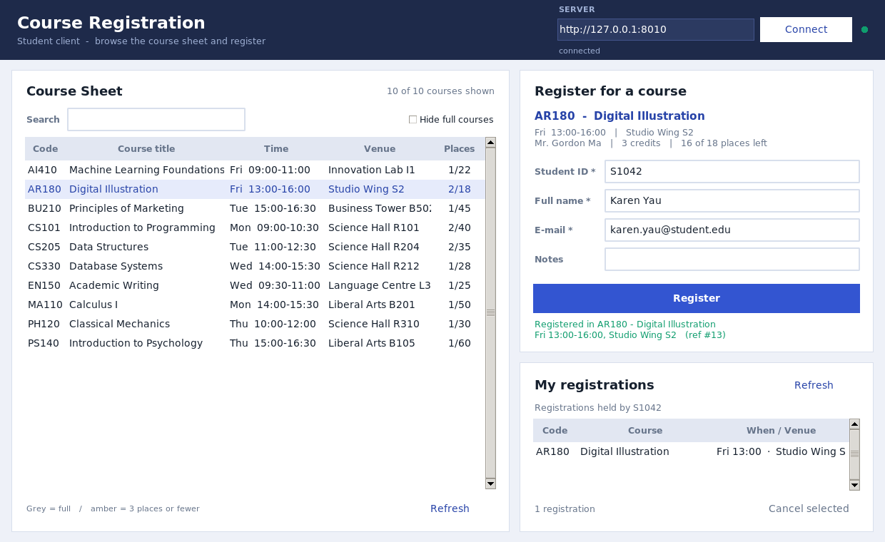
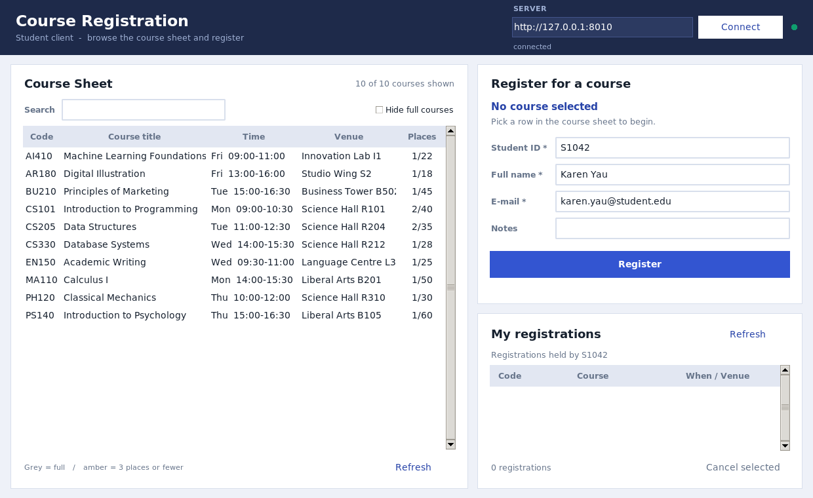
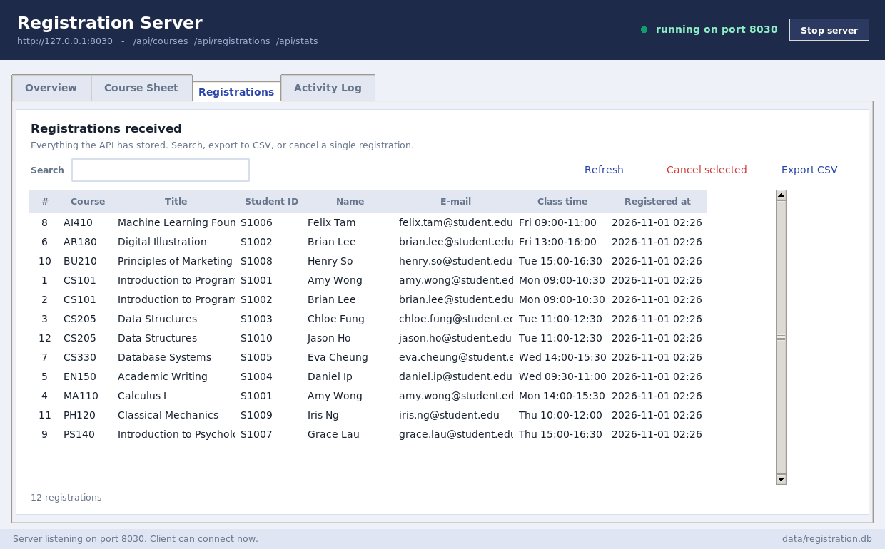
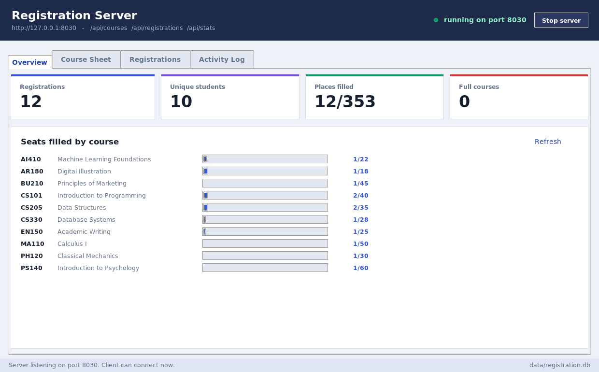
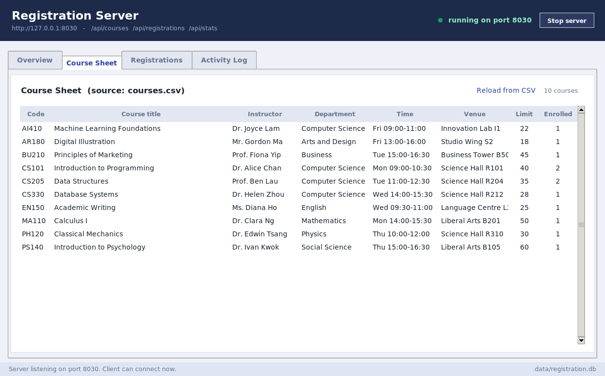

# Class Registration System (Python)

A complete, working class-registration project in three parts, built entirely on the
Python standard library — **no pip installs required**.

| # | Item | File(s) | What it is |
|---|------|---------|------------|
| 1 | **Course Sheet** | `courses.csv` (+ Course Sheet tab in `server_gui.py`) | Every course with its time, venue and candidate limit (capacity). It is the single source of truth: edit the CSV, press *Reload from CSV*, and the whole system follows. |
| 2 | **Client-side program** | `client_gui.py` | Desktop GUI where a student browses the sheet, registers for a course, and reviews or cancels their own registrations. |
| 3 | **Server-side program** | `server.py` (JSON API + SQLite) and `server_gui.py` (desktop console) | Receives and stores every registration, enforces the rules, and lets staff retrieve, search, export and cancel registrations. |



---

## 1. Quick start (two steps)

Open two terminals in this folder.

**Terminal 1 — the server** (also creates the SQLite database):

```bash
python3 server_gui.py            # desktop console on http://0.0.0.0:8000
# or, headless / command line only:
python3 server.py --demo         # --demo inserts a few sample registrations
```

**Terminal 2 — the client:**

```bash
python3 client_gui.py                       # connects to http://127.0.0.1:8000
python3 client_gui.py --server http://192.168.1.20:8000   # connect to another machine
```

Requirements: **Python 3.10+ with Tkinter** (bundled with the python.org installers on
Windows/macOS; on Debian/Ubuntu: `sudo apt install python3-tk`).

Run the self-checks any time with:

```bash
python3 test_registration.py       # 11 tests: rules + live HTTP round-trip
```

---

## 2. Item 1 — the Course Sheet

`courses.csv` holds one row per course:

| column | meaning |
|--------|---------|
| `code` | unique course code, e.g. `CS101` |
| `title`, `instructor`, `department`, `description` | course details |
| `day`, `start`, `end` | timetable slot, e.g. `Mon`, `09:00`, `10:30` |
| `venue` | where the class meets |
| `capacity` | **candidate limit** — the maximum number of students |
| `credits` | credit weighting |

```
code,title,instructor,department,day,start,end,venue,capacity,credits,description
CS101,Introduction to Programming,Dr. Alice Chan,Computer Science,Mon,09:00,10:30,Science Hall R101,40,3,...
```

Ways to view it:

* **Server console → Course Sheet tab** — the full table plus live enrolment.
* **Browser** — open `http://127.0.0.1:8000/` while the server runs for a read-only HTML sheet.
* **JSON** — `GET /api/courses` returns the sheet with `enrolled` and `seats_left` added.

Editing the sheet: change the CSV, then press **Reload from CSV** in the console (or
restart the server). New courses are added, edited rows are updated, and existing
registrations are kept.

---

## 3. Item 2 — the client program (`client_gui.py`)



* **Course Sheet panel** — live list of every course with day/time, venue and
  `enrolled / capacity`. Search box filters by code, title, instructor or venue;
  *Hide full courses* tidies the list. Rows turn **grey** when a course is full and
  **amber** when three or fewer places remain.
* **Register panel** — pick a row, the panel shows the course details and places left,
  fill in student ID, full name, e-mail and optional notes, then press **Register**.
  A green line confirms the seat with a registration reference number; problems appear
  in red/amber in the same place (full, duplicate, timetable clash, bad e-mail …).
* **My registrations panel** — the selected student's registrations, with
  **Cancel selected** to withdraw.
* The server address can be changed at the top; **Connect** re-points the client and the
  status light shows connected / offline. The last server address and student details
  are remembered in `data/client_settings.json`.

Every network call runs in a background thread, so the window never freezes while it
waits for the server.

---

## 4. Item 3 — the server program

### 4a. `server.py` — the API and database

* `http.server.ThreadingHTTPServer` + `sqlite3` (`data/registration.db`, created automatically).
* Loads the course sheet from `courses.csv` at start-up (upsert, so re-running is safe).
* Enforces the rules **on the server**, inside a locking transaction, so two clients can
  never take the last seat or double-book a student:

| rule | error code | HTTP |
|------|-----------|------|
| student ID 3–20 chars, real-looking e-mail, name present | `VALIDATION` | 400 |
| course exists on the sheet | `NO_SUCH_COURSE` | 404 |
| course capacity not exceeded | `FULL` | 409 |
| one registration per student per course | `DUPLICATE` | 409 |
| no two classes at the same time for one student | `TIME_CONFLICT` | 409 |

**Endpoints**

| Method | Path | Purpose |
|--------|------|---------|
| `GET` | `/api/health` | is the server up? |
| `GET` | `/api/courses` | the course sheet + live enrolment |
| `GET` | `/api/registrations?course_code=&student_id=&q=` | **retrieve** registrations (filter/search) |
| `POST` | `/api/registrations` | register `{course_code, student_id, student_name, email, notes}` |
| `DELETE` | `/api/registrations/<id>` | cancel one registration |
| `GET` | `/api/stats` | totals for dashboards |
| `GET` | `/` | HTML view of the course sheet |

```bash
curl http://127.0.0.1:8000/api/courses
curl -X POST http://127.0.0.1:8000/api/registrations \
     -H 'Content-Type: application/json' \
     -d '{"course_code":"CS101","student_id":"S1042","student_name":"Karen Yau","email":"karen@student.edu"}'
curl "http://127.0.0.1:8000/api/registrations?course_code=CS101"
```

Flags: `--host` (default `0.0.0.0`), `--port` (default `8000`), `--db`, `--courses`,
`--demo`.

### 4b. `server_gui.py` — the retrieval console

Starts the same API in a background thread and adds a desktop console for staff:

| Tab | Contents |
|-----|----------|
| **Overview** | live counters (registrations, unique students, places filled, full courses) and a fill bar per course |
| **Course Sheet** | the full sheet with limit vs enrolled, reload straight from `courses.csv` |
| **Registrations** | every registration received — searchable, **Export CSV**, **Cancel selected** |
| **Activity Log** | the server's request log, newest at the bottom |







The console's top-right button stops/starts the API without closing the window, and the
tab bar refreshes automatically every two seconds while you are looking at data.

---

## 5. Files

```
class_registration/
├── courses.csv              # ITEM 1 - the course sheet
├── client_gui.py            # ITEM 2 - student client (GUI)
├── server.py                # ITEM 3 - registration API + SQLite storage
├── server_gui.py            # ITEM 3 - server console (GUI)
├── theme.py                 # shared colours/fonts/widget styles for both GUIs
├── test_registration.py     # 11 self-checks (rules + HTTP round-trip)
├── README.md
├── data/                    # created at run time: registration.db, client_settings.json
└── screenshots/
```

## 6. How a registration flows

```
client_gui.py                     server.py                        data/registration.db
    │  POST /api/registrations        │                                     │
    ├────────────────────────────────►│ validate → lock → check capacity,   │
    │                                 │ duplicate, timetable clash          │
    │                                 ├────────────────────────────────────►│ INSERT
    │  201 {"registration": {...}}    │                                     │
    │◄────────────────────────────────┤                                     │
    │  refresh sheet + my list        │                                     │
```

## 7. Ideas to extend it

* Real student accounts: add a `students` table with hashed passwords and a login screen.
* Waitlists: when `capacity` is reached, store the request with status `waitlisted`.
* Prerequisites (e.g. `AI410` needs `MA110`) — the fields already exist in the CSV.
* E-mail confirmations, a web front end served by `server.py`, or a timetable grid view.

_Tested with Python 3.13 on Linux; Tkinter GUIs will run unchanged on Windows and macOS._
